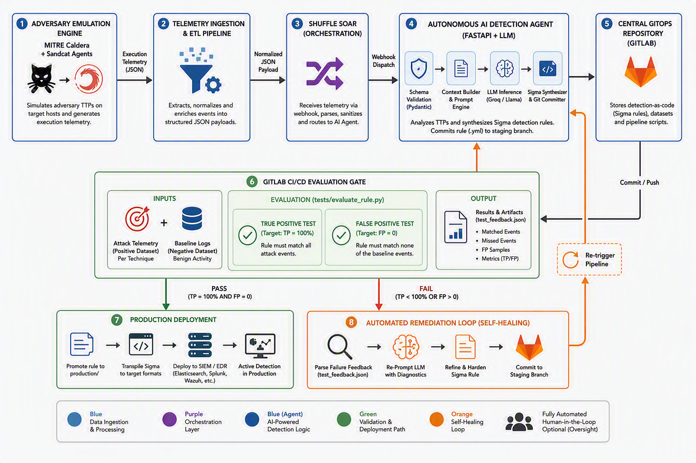
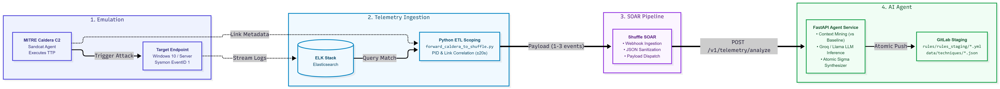
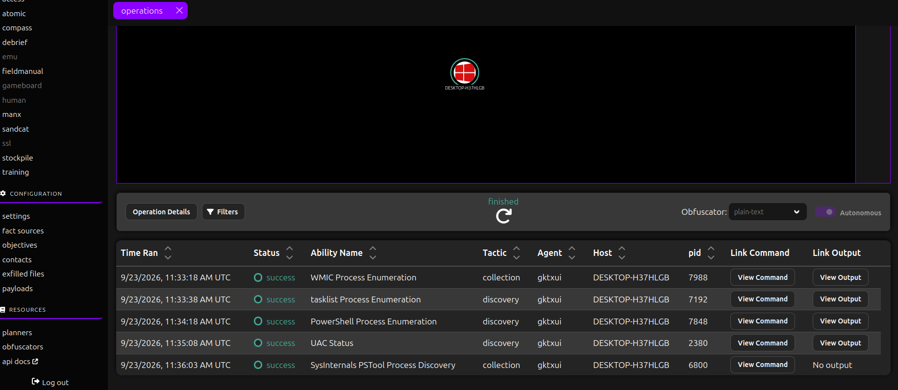
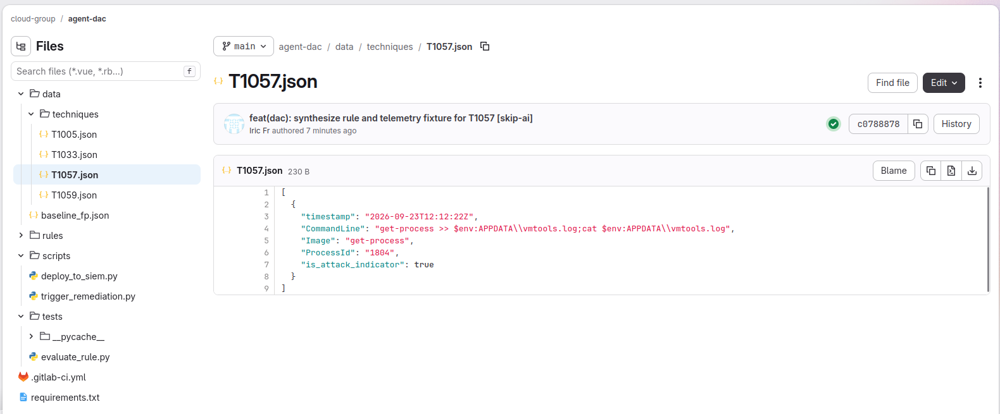
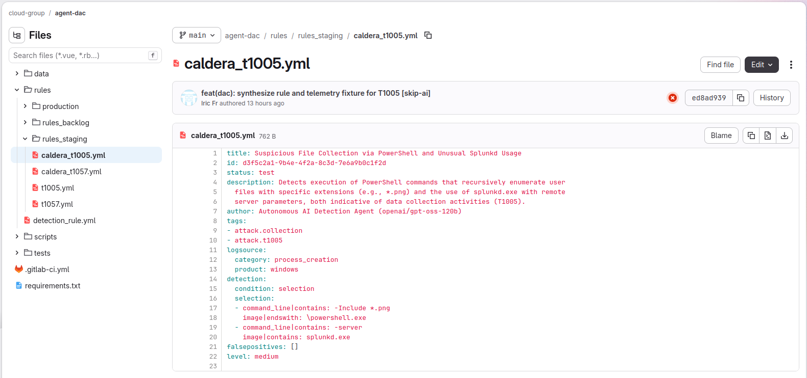
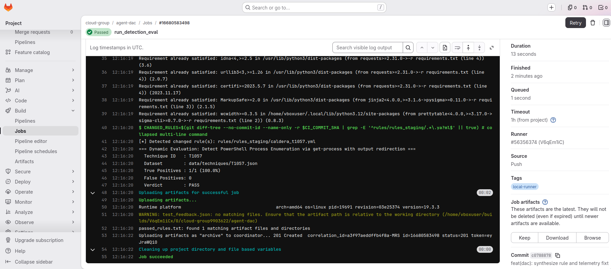
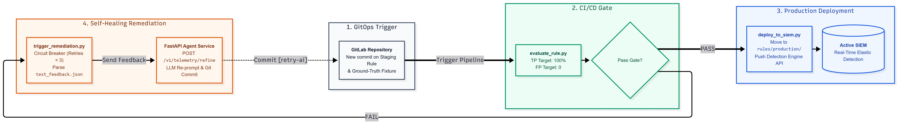
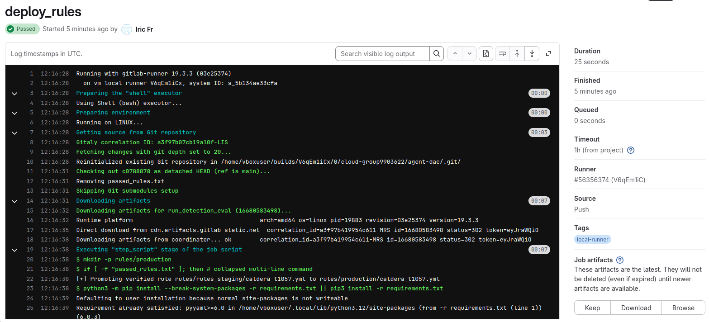
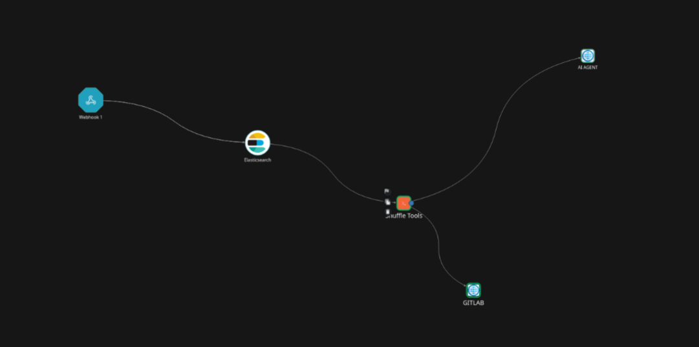

# Closed-Loop Detection-as-Code

Autonomous Sigma rule synthesis, verification, and SIEM deployment driven directly by adversary emulation telemetry — no human-authored detection logic in the critical path.

MITRE Caldera executes an ability on a target host. An ETL stage scopes the resulting Sysmon/PowerShell telemetry to that exact ability's execution window. A FastAPI service backed by an LLM synthesizes a Sigma rule as a schema-validated structured output and commits it to Git. A CI pipeline evaluates the rule against a true-positive fixture and a benign baseline corpus. If it passes, it's promoted to production and pushed to the Elastic Detection Engine API. If it fails, the pipeline re-prompts the model with the exact miss/false-positive diagnostics and tries again, bounded by a retry counter so a rule that won't converge doesn't burn API budget indefinitely.

The interesting engineering problem here turned out not to be rule generation. It was telemetry scoping — see [Ground-truth poisoning](#ground-truth-poisoning) below.

## Architecture



The system runs in two phases that share a Git repository as their only synchronization point.

**Phase 1 — detection engineering**, triggered by Caldera operation completion: Sandcat agent execution → Sysmon/PowerShell telemetry into Elastic data streams → per-link ETL scoping → Shuffle webhook dispatch → FastAPI agent service → atomic commit of the Sigma rule and its ground-truth fixture to `main`.

**Phase 2 — verification and promotion**, triggered by that commit: GitLab CI evaluation gate → pass/fail → either promotion to `rules/production/` and a push to Kibana's Detection Engine API, or a feedback artifact routed back into the agent for refinement.

| Subsystem | Runtime | Interface | Responsibility |
|---|---|---|---|
| Caldera C2 | Python 3, Sandcat agent | REST `/api/v2` | Ability chain execution, PID/timestamp emission |
| ETL scoper | Python 3, `requests` | Elasticsearch `_search` | Per-link temporal + PID correlation |
| Shuffle SOAR | Workflow engine | Webhook, HTTP node | Payload routing, execution trace |
| AI agent | FastAPI, Uvicorn | `POST /v1/telemetry/*` | Sigma synthesis, refinement, GitOps commit |
| CI gate | GitLab Runner (shell executor) | `.gitlab-ci.yml` | TP/FP evaluation, promotion trigger |
| Deployer | Python 3, `pySigma` | Kibana Detection Engine API | Transpilation, upsert |

## Ground-truth poisoning

The first version of this pipeline extracted telemetry per Caldera *operation*: take the start/finish timestamps, pull every Sysmon and PowerShell event in that window, hand the batch to the model as the positive-class fixture for whatever technique the operation claimed to exercise.

A single operation against T1005 (Data from Local System) ran for about three minutes and generated 62 heterogeneous events — `wmic` enumeration, `tasklist` calls, UAC checks, background OS noise — none of which were the attack itself. All 62 landed in `T1005.json` as ground truth. Since the evaluator requires the rule to match every entry in that file, the model had two options: write a loose rule matching all 62 (which then fires on the benign baseline and fails the FP gate), or write a correct, narrow rule and get a 3.4% true-positive rate against a fixture that was wrong at the event level for 60 of its 62 entries.

The fix (`forward_caldera_to_shuffle.py`) scopes per Caldera *link* instead of per operation: a ±20 second window around the link's own `decide`/`finish` timestamp, filtered by that link's PID, with a secondary command-line token correlation as a backstop when Elastic Agent's harvest lags the Caldera timestamp.

```python
def query_siem_for_link(step_pid, step_cmd, link_time, tolerance_seconds=20):
    center_time = parse_iso(link_time)
    start_dt = center_time - timedelta(seconds=tolerance_seconds)
    end_dt = center_time + timedelta(seconds=tolerance_seconds)
    if step_pid and int(step_pid) > 0:
        correlation_filters.append({"term": {"process.pid": int(step_pid)}})
        correlation_filters.append({"term": {"winlog.event_data.ProcessId": int(step_pid)}})
```

Same evaluator, same 80%/0-FP gate, same LLM prompt — moving from operation-scoped to link-scoped extraction took T1005 from 3.4% to 100% TP with zero changes to the synthesis logic. Telemetry hygiene at the fixture-construction layer mattered more than anything downstream of it.



When no Elasticsearch document falls inside the ±20s window — which happens when the harvest interval lags, or when Caldera itself never reports a PID for the ability (observed on the `UAC Status` link, T1518.001) — the scoper falls back to synthesizing a single execution artifact directly from Caldera's own `command` string, tagged `is_attack_indicator: true`. It's a pragmatic compromise: the fixture reflects what Caldera says it ran, not necessarily what Sysmon observed, and the two can diverge silently if shell expansion changes the actual invocation. See [Limitations](#limitations).



## Rule synthesis

`agent/main.py` exposes two endpoints: `/v1/telemetry/analyze` always produces a new staging file, `/v1/telemetry/refine` overwrites an existing one by resolving the technique ID out of the failing rule's `tags`. Both paths normalize technique IDs through the same regex (`\b(T\d{4}(?:\.\d{3})?)\b`) and resolve to a deterministic staging path — `rules/rules_staging/<technique>.yml` — with no operation-name prefix, so a second run against the same technique overwrites rather than duplicates.

Rule generation goes through `SigmaRuleOutput`, a Pydantic model bound to the Groq-hosted model via structured output / function calling, not a free-text completion parsed after the fact. The system prompt carries five hard constraints; the one that mattered most in practice was banning bare-utility-name matches (`Image|endswith: whoami.exe` with no command-line qualifier) — technically a true positive against a thin fixture, a guaranteed false positive against any baseline with routine admin activity.

Discriminative tokens for refinement come out of `extract_dynamic_evidence`, which builds a benign-corpus blob from the false-positive samples and rejects any candidate token that appears in it or in a short noise blacklist (`cmd.exe`, `powershell.exe`, `conhost.exe`, `system32`, …) before ranking the survivors by frequency.

```python
for t in tokens:
    if t.lower() not in noise_blacklist and t.lower() not in benign_blob:
        token_counter[t] += 1
```

Example output — T1057, Process Discovery via a `get-process` invocation redirected to a file under `%APPDATA%`:



```yaml
title: Detect PowerShell Process Enumeration via get-process with Output Redirection
id: 7f2c9e14-3b8a-4e1d-9a6c-1d4f8b2e7c30
status: test
description: Detects PowerShell get-process invocations redirected to a file
  under %APPDATA%, a pattern consistent with local process-discovery staging.
author: Autonomous AI Detection Agent (openai/gpt-oss-120b)
tags:
  - attack.discovery
  - attack.t1057
logsource:
  category: process_creation
  product: windows
detection:
  selection:
    CommandLine|contains:
      - 'get-process'
      - 'APPDATA'
  condition: selection
falsepositives:
  - Administrative process auditing scripts
level: medium
```

And the T1005 rule that resulted once the poisoning fix landed — note the compound, two-clause selection rather than a single bare match:



## Verification gate and self-healing

`tests/evaluate_rule.py` flattens arbitrary nested log structures (ECS, Winlogbeat, synthesized fixtures) into a single key-value view and matches Sigma field specs against it by suffix, which is what lets one rule evaluate cleanly against both a raw Caldera-derived fixture and a full ECS document with no schema-mapping layer in between.

Pass condition: true-positive rate of at least 80% *and* zero matches against `data/baseline_fp.json`. The 80% threshold (rather than a strict 100%) is a concession to single-event fixtures, where the two numbers are functionally identical anyway; the false-positive side has no slack at all.

$$\text{TPR} = \frac{\sum \text{Matched Attack Events}}{\text{Total Scoped Attack Events}} \qquad \text{FPC} = \sum \text{Matched Baseline Events}$$



A failure writes `test_feedback.json` — the raw rule, up to eight missed-event field dumps, up to five matched false-positive samples with the triggering clause — which `scripts/trigger_remediation.py` reads before deciding whether to re-prompt. The circuit breaker counts prior `[retry-ai]` tokens in `git log` and stops re-triggering once that count hits 3, so a rule oscillating between failure modes doesn't run up the API bill indefinitely. It's intentionally stateless — no separate counter service — which also means a force-push or rebase on the staging branch resets it with no explicit guard. Worth hardening before this runs anywhere with untrusted contributors.



## Deployment

A passing rule moves from `rules/rules_staging/` to `rules/production/` and, when Kibana credentials are configured, gets transpiled to a Lucene query via `pySigma`'s `LuceneBackend` and pushed to the Detection Engine API. Transpilation failures fall back to a wildcard query rather than blocking promotion — getting the rule file into `rules/production/` matters more than a working live query on the first attempt, since the latter is a one-line re-run once fixed and the former is easy to lose track of if it silently never happens.

One recurring integration snag worth noting if you're building against the same API: Kibana's Detection Engine expects an `Authorization: ApiKey <value>` header, not `Bearer`, and the key-generation endpoint doesn't tell you that.

```python
"Authorization": (
    f"ApiKey {api_key}" if not api_key.startswith("ApiKey ") else api_key
),
```

A `409` on rule creation is treated as "already exists" and routed to `PATCH` instead of failing the deploy.



## Orchestration

Shuffle sits between the ETL script and the agent service purely to decouple their execution cadence and give a visual trace when a dispatch fails — it's not doing meaningful transformation work, just webhook ingestion, an Elasticsearch lookup pass-through, and routing to the AI agent node.



## Repository layout

```
.
├── agent/
│   ├── main.py                  # FastAPI endpoints: /v1/telemetry/analyze, /refine
│   ├── config.py
│   ├── schemas.py                # Pydantic models, incl. SigmaRuleOutput
│   └── services/
│       ├── agent_service.py      # Prompting, token mining, rule generation
│       └── gitlab_service.py     # GitOps commit layer
├── data/
│   ├── techniques/                # Per-technique ground-truth fixtures (T1057.json, ...)
│   └── baseline_fp.json           # Benign baseline corpus
├── rules/
│   ├── rules_staging/              # AI-generated, unverified
│   └── production/                 # CI-promoted, deployed
├── scripts/
│   ├── deploy_to_siem.py
│   └── trigger_remediation.py
├── tests/
│   └── evaluate_rule.py            # TP/FP gate
├── forward_caldera_to_shuffle.py   # ETL scoping engine
└── .gitlab-ci.yml
```

## Running it

Requires a MITRE Caldera instance with a Sandcat agent beaconing on the target host, an Elastic Stack ingesting Sysmon (Event ID 1), PowerShell Operational, and Security event channels, a Shuffle instance for orchestration, and a Groq API key for model inference.

```bash
pip install -r requirements.txt --break-system-packages
python3 -m uvicorn agent.main:app --host 0.0.0.0 --port 8000 --reload
python3 forward_caldera_to_shuffle.py
```

CI/CD runs on a self-hosted GitLab Runner (shell executor); `.gitlab-ci.yml` defines the `run_detection_eval` and `deploy_rules` stages.

## Results

| Technique | Window (raw → scoped) | Events | Pre-patch TP | Post-patch TP | FP | Verdict |
|---|---|---|---|---|---|---|
| T1005 | 180s → ±20s | 62 → 1 | 3.4% | 100% (1/1) | 0 | PASS |
| T1057 | ±20s (direct) | 1 | — | 100% (1/1) | 0 | PASS |
| T1047 | ±20s (direct) | 1 | — | queued | — | — |
| T1518.001 | ±20s (synthesized) | 1 | — | queued | — | — |

## Limitations

- Per-link scoping assumes one attacker action maps to one PID-identifiable process launch in a narrow window. Multi-stage living-off-the-land chains — a dropper spawning a child that injects into a long-lived host process — aren't captured; there's no parent/child lineage traversal, only a flat PID/timestamp filter.
- Synthesized fixtures (used when Elastic lags Caldera) reflect Caldera's declared command, not necessarily what actually executed. No reconciliation pass checks a synthesized fixture against the real event once it eventually lands.
- The baseline FP corpus is loaded into memory wholesale on every evaluation run with no incremental indexing; this won't scale past a few thousand baseline events without a rewrite.
- The circuit breaker's state lives in commit message history, not a persisted counter — rebasing or force-pushing the staging branch silently resets it.
- Credentials in the ETL script (Caldera API key, Elasticsearch password) are lab-appropriate, not production-appropriate. Move them to a secrets manager before running this outside an isolated range.
- No visibility into encrypted network telemetry — this is endpoint/process-focused, with no TLS inspection or C2 traffic fingerprinting.

## Roadmap

- Multi-backend transpilation via `pySigma`'s pluggable backends — Splunk, Wazuh, Sentinel — alongside the current Elasticsearch/Lucene path.
- Automated honeypot-token deployment synchronized with the Caldera emulation loop, extending false-positive validation from static baseline replay to live deception-based checks.
- Lineage-aware correlation for multi-stage process chains, replacing the flat PID/timestamp filter with parent/child traversal.
